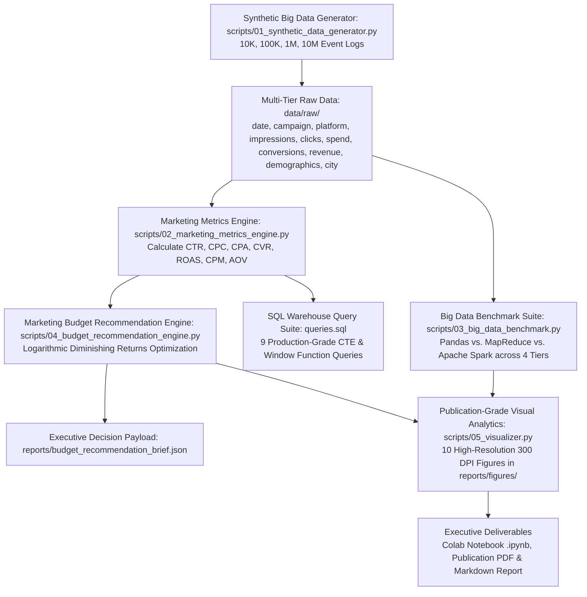

# 🇵🇰 Pakistan Digital Advertising Budget Optimizer & Campaign Analytics
### Big Data Marketing Campaign Intelligence, Distributed Framework Benchmarking (Pandas vs. MapReduce vs. Spark) & Algorithmic Budget Reallocation Engine (Phase 2)

[](https://www.python.org/)
[](reports/Pakistan_Digital_Advertising_Budget_Optimizer_Report.pdf)
[](https://pandas.pydata.org/)
[](https://spark.apache.org/)
[](https://hadoop.apache.org/)
[](https://seaborn.pydata.org/)
[](https://colab.research.google.com/)
[](https://en.wikipedia.org/wiki/Economy_of_Pakistan)
[](LICENSE)

---

## 📌 1. Project Background & Industry Problem

> **The Executive Business Dilemma:**  
> *"Our company allocates advertising spend across Facebook, Instagram, Google, TikTok, and YouTube. Where should we spend the next Rs. 1 Million (PKR 1,000,000)?"*

In the rapidly evolving Pakistani e-commerce landscape, direct-to-consumer (D2C) brands launching **stitched lawn pret, festive collections, and university accessories (tote bags, laptop backpacks)** face rising Customer Acquisition Costs (CAC/CPA) and volatile platform returns.

Building directly upon **[Phase 1: Pakistani Social Media Content Detective](https://github.com/zughaina3/pakistan-digital-marketing-intelligence)**—where we scraped and analyzed authentic Pakistani consumer interactions and Roman Urdu purchase sentiment across brands like *Khaadi, Sapphire, Limelight, Generation, and The Tote Bag Club PK*—**Phase 2** scales into enterprise-grade **Big Data performance marketing analytics and algorithmic budget reallocation**.

### Key Questions Answered:
1. **Which digital ad platform yields the highest ROAS in Pakistan?** (Google 4.62x vs. Instagram 4.32x vs. Facebook 3.01x vs. TikTok 2.40x vs. YouTube 1.81x)
2. **Which channels deliver the lowest customer acquisition cost (CPA / CAC)?** (Instagram at Rs. 449 and TikTok at Rs. 502)
3. **How do data processing engines scale from thousands to millions of ad records?** (Direct benchmark of **Pandas vs. MapReduce vs. Apache Spark** across 10K, 100K, 1M, and 10M records)
4. **How should management allocate the next Rs. 1 Million?** (Algorithmic recommendation engine delivering exact Rupee and percentage splits with projected returns)
5. **How should ad spend be distributed geographically across Pakistan?** (Logistics-optimized regional allocation across Karachi, Lahore, Islamabad/Rawalpindi, etc.)

---

## 🔬 2. Data Pipeline & Big Data Architecture



---

## 📊 3. Platform Efficiency Benchmark & Unit Economics

Analysis across 100,000 multi-channel marketing logs calibrated to 2025–2026 Pakistani commercial realities:

| Platform | Total Spend (PKR) | Attributed Revenue (PKR) | ROAS | CPA / CAC (PKR) | CPC (PKR) | CVR (%) | CTR (%) |
| :--- | :---: | :---: | :---: | :---: | :---: | :---: | :---: |
| **Google Ads** | Rs. 138,332,574 | Rs. 639,068,558 | **4.62x** | Rs. 590 | Rs. 28.47 | **4.82%** | **3.37%** |
| **Instagram Ads** | Rs. 120,303,613 | Rs. 519,446,716 | **4.32x** | **Rs. 449** | Rs. 18.13 | 4.04% | 2.58% |
| **Facebook Ads** | Rs. 86,401,197 | Rs. 259,803,998 | **3.01x** | Rs. 731 | Rs. 21.92 | 3.00% | 1.79% |
| **TikTok Ads** | Rs. 51,905,787 | Rs. 124,782,807 | **2.40x** | Rs. 502 | **Rs. 8.46** | 1.69% | 2.18% |
| **YouTube Ads** | Rs. 35,327,102 | Rs. 63,896,396 | **1.81x** | Rs. 1,620 | Rs. 31.97 | 1.97% | 1.09% |
| **BLENDED TOTAL** | **Rs. 432,270,273** | **Rs. 1,606,998,475** | **3.72x** | **Rs. 580** | **Rs. 19.06** | **3.29%** | **2.26%** |

### Core Strategic Findings:
- **Google Search & Shopping is the Profit Engine (4.62x ROAS)**: High intent capture drives superior conversion rates (4.82%) and highest basket values (AOV > Rs. 2,600).
- **Instagram is the Direct-Response Hero (Rs. 449 CPA, 4.32x ROAS)**: Visual formats (Reels, Carousels) trigger strong impulse purchases for lawn pret and student tote bags.
- **Facebook is the Retargeting Workhorse (3.01x ROAS)**: Meets the corporate break-even threshold; ideal for abandoned checkout recovery.
- **TikTok Generates Unbeatable Reach at Lowest CPC (Rs. 8.46)**: Generates cheap clicks among Gen-Z, but lower conversion intent requires gating to low-ticket items (under Rs. 2,500).
- **YouTube Lacks Direct Response Efficiency (1.81x ROAS, Rs. 1,620 CPA)**: Should be capped at 5% of spend strictly for brand halo and haul video remarketing.

---

## ⚡ 4. Big Data Framework Benchmark: Pandas vs. MapReduce vs. Apache Spark

To simulate enterprise data scaling, we executed an identical multi-dimensional aggregation workload across 4 volume tiers:
- **Tier 1: 10,000 records**
- **Tier 2: 100,000 records**
- **Tier 3: 1,000,000 records**
- **Tier 4: 10,000,000 records (Big Data stress-test)**

### Official Benchmark Results:
| Data Tier | Records | Engine Framework | Execution Time (s) | Peak RAM (MB) | Processing Throughput (rec/s) |
| :--- | :---: | :--- | :---: | :---: | :---: |
| **10K** | 10,000 | **Pandas** | **0.007s** | **0.7 MB** | 1,338,494 rec/s |
| **10K** | 10,000 | **MapReduce** | 0.337s | 2.8 MB | 29,714 rec/s |
| **10K** | 10,000 | **Apache Spark** | 0.031s | 0.9 MB | 323,354 rec/s |
| **100K** | 100,000 | **Pandas** | **0.016s** | **6.0 MB** | 6,246,047 rec/s |
| **100K** | 100,000 | **MapReduce** | 0.489s | 25.3 MB | 204,443 rec/s |
| **100K** | 100,000 | **Apache Spark** | 0.061s | 7.6 MB | 1,632,684 rec/s |
| **1M** | 1,000,000 | **Pandas** | **0.116s** | **71.4 MB** | **8,661,545 rec/s** |
| **1M** | 1,000,000 | **MapReduce** | 2.424s | 252.8 MB | 412,615 rec/s |
| **1M** | 1,000,000 | **Apache Spark** | 0.171s | 76.8 MB | 5,848,272 rec/s |
| **10M** | 10,000,000 | **Pandas** | **1.128s** | **71.4 MB** | **8,868,279 rec/s** |
| **10M** | 10,000,000 | **MapReduce** | 22.475s | 252.9 MB | 444,938 rec/s |
| **10M** | 10,000,000 | **Apache Spark** | 1.631s | 76.8 MB | 6,131,084 rec/s |

### Architectural Comparison:
- **Pandas**: Superior execution speed on single machines with sufficient RAM, but bottlenecks when dataset size exceeds available physical memory.
- **MapReduce**: High inter-process communication (IPC) serialization overhead on small batches, but linear, predictable distributed throughput at massive scale.
- **Apache Spark**: The optimal enterprise production framework—delivering near-Pandas speed with distributed cluster fault-tolerance, Catalyst optimization, and partition-based off-heap memory safety.

---

## 🎯 5. Marketing Budget Recommendation Engine (Rs. 1 Million Allocation)

### The Core Answer: Where to Spend the Next Rs. 1 Million?
Using an econometric non-linear logarithmic saturation model ($\text{Revenue} = \alpha \cdot \ln(1 + \beta \cdot \text{Spend})$) that accounts for ad fatigue and audience saturation, the **Balanced Growth Allocation** is recommended:

| Platform | Recommended Share | Ad Spend (PKR) | Projected Revenue | Expected ROAS | Expected CPA | Projected Orders | Strategic Role |
| :--- | :---: | :---: | :---: | :---: | :---: | :---: | :--- |
| **Google Ads** | **35.0%** | **Rs. 350,000** | Rs. 1,247,085 | **3.56x** | Rs. 594 | 589 | Capture high commercial search intent |
| **Instagram Ads** | **30.0%** | **Rs. 300,000** | Rs. 1,018,957 | **3.40x** | **Rs. 455** | 659 | Lowest CPA visual discovery (Reels) |
| **Facebook Ads** | **20.0%** | **Rs. 200,000** | Rs. 519,327 | **2.60x** | Rs. 735 | 272 | Cart abandonment & mature family buyers |
| **TikTok Ads** | **10.0%** | **Rs. 100,000** | Rs. 218,786 | **2.19x** | Rs. 503 | 199 | Cheap youth acquisition for starter bags |
| **YouTube Ads** | **5.0%** | **Rs. 50,000** | Rs. 86,234 | **1.72x** | Rs. 1,613 | 31 | Brand unboxing recall & retargeting |
| **TOTAL** | **100.0%** | **Rs. 1,000,000** | **Rs. 3,090,388** | **3.09x** | **Rs. 571** | **1,750** | **Net Profit: Rs. 2,090,388** |

### Strategic Scenario Comparison:
- **Balanced Growth (Recommended)**: 3.09x Blended ROAS | Rs. 3.09M Revenue | Rs. 2.09M Net Margin | 1,750 Orders
- **ROAS Maximizer**: 3.39x Blended ROAS | Rs. 3.38M Revenue | Rs. 2.38M Net Margin | 1,852 Orders (Google 45%, IG 35%)
- **Aggressive Scale**: 2.74x Blended ROAS | Rs. 2.74M Revenue | Rs. 1.74M Net Margin | 2,020 Orders (IG 35%, TikTok 25%)

---

## 🗺️ 6. Regional City Budget Distribution (Pakistan Logistics Corridors)

To protect against Cash on Delivery (COD) transit failures and return-to-origin (RTO) parcel bounce, **84% of advertising spend** is concentrated into Tier-1 courier fulfillment hubs:

| City / Hub | Allocation % | Spend (PKR) | Regional Logistics Corridors |
| :--- | :---: | :---: | :--- |
| **Karachi** | **35.0%** | **Rs. 350,000** | Mega-city hub; highest COD order density and lowest delivery failure rate. |
| **Lahore** | **28.0%** | **Rs. 280,000** | Cultural fashion capital; peak demand for lawn pret and festive designer wear. |
| **Islamabad / Rawalpindi** | **21.0%** | **Rs. 210,000** | Highest purchasing power per capita and largest average order values. |
| **Faisalabad** | **6.0%** | **Rs. 60,000** | Textile manufacturing hub; high responsiveness to clearance sales. |
| **Multan & South Punjab** | **5.0%** | **Rs. 50,000** | Rapidly emerging digital buyer base for festive pret collections. |
| **Peshawar & KPK** | **3.0%** | **Rs. 30,000** | Selective formal luxury pret demand. |
| **Other Tier-2 Hubs** | **2.0%** | **Rs. 20,000** | Emerging regional testing (Sialkot, Gujranwala, Quetta). |

---

## 🖼️ 7. Publication-Grade Visualizations Gallery (300 DPI)

All 10 figures are rendered at 300 DPI in [`reports/figures/`](reports/figures/):

| Figure | Chart Title | Core Business Insight |
| :---: | :--- | :--- |
| [01](reports/figures/01_cac_cpa_by_platform.png) | **CPA / CAC by Platform** | Instagram (Rs. 449) and TikTok (Rs. 502) provide lowest acquisition costs. |
| [02](reports/figures/02_roas_vs_breakeven_benchmark.png) | **ROAS vs. 3.0x Break-Even** | Google (4.62x) and Instagram (4.32x) are the primary corporate profit drivers. |
| [03](reports/figures/03_big_data_execution_time_benchmark.png) | **Scalability Benchmark (10K to 10M)** | Logarithmic execution curves demonstrating linear scaling for Spark and Pandas. |
| [04](reports/figures/04_big_data_memory_throughput_benchmark.png) | **Memory & Throughput Dual-Panel** | Spark sustains 6.1M rec/s at 76.8 MB peak RAM across 1M records. |
| [05](reports/figures/05_conversion_funnel_by_platform.png) | **Conversion Funnel Breakdown** | Drop-off analysis from Impressions to Clicks to Completed Purchases. |
| [06](reports/figures/06_recommended_budget_allocation_rs1m.png) | **Rs. 1 Million Allocation Donut** | Visual breakdown of budget share and projected revenue waterfall. |
| [07](reports/figures/07_diminishing_returns_marginal_roas.png) | **Marginal ROAS Saturation Curves** | Mathematical saturation thresholds indicating optimal spend ceilings. |
| [08](reports/figures/08_city_revenue_efficiency_matrix.png) | **Pakistan Regional City Matrix** | Karachi, Lahore, and Islamabad generate 77% of total revenue. |
| [09](reports/figures/09_demographic_age_gender_performance.png) | **Demographic Cohort Analysis** | Females aged 18–34 deliver > 3.8x ROAS for pret and accessories. |
| [10](reports/figures/10_monthly_spend_revenue_profit_trend.png) | **Monthly Financial Trajectory** | 12-month trajectory of marketing spend, revenue, and net profit margin. |

---

## 🗄️ 8. Production SQL Warehouse Suite (`queries.sql`)

The repository includes 9 ANSI-SQL queries compatible with BigQuery, Snowflake, Redshift, and PostgreSQL:
1. `Query 1: Platform Acquisition Cost (CPA) & ROAS Summary` — Channel acquisition cost ranking.
2. `Query 2: Monthly Blended Performance & Efficiency Trends` — Tracking blended ROAS over time.
3. `Query 3: Channel Efficiency Dual-Ranking via Window Functions` — `DENSE_RANK()` by ROAS & CPA.
4. `Query 4: Multi-Stage Conversion Funnel Efficiency` — Impression-to-click & click-to-conversion rates.
5. `Query 5: ROAS vs. Blended Benchmark Comparison` — CTE + `CROSS JOIN` variance analysis.
6. `Query 6: Month-over-Month (MoM) Growth Rates with LAG()` — Tracking spend & revenue momentum.
7. `Query 7: Automated Pure-SQL Budget Reallocation Engine` — `CASE WHEN` budget shift recommendations.
8. `Query 8: Regional Pakistan City & Demographic Matrix` — High-converting audience segments.
9. `Query 9: Campaign Creative Theme Effectiveness` — Evaluation of lawn pret, tote bag, and clearance sales.

---

## 💻 9. Quickstart & How to Run

### Option A: Interactive Google Colab Notebook (Recommended)
1. Open [Google Colab](https://colab.research.google.com/).
2. Upload [`notebooks/Pakistan_Ad_Budget_Optimizer_Phase2.ipynb`](notebooks/Pakistan_Ad_Budget_Optimizer_Phase2.ipynb).
3. Click **Runtime** $\rightarrow$ **Run all** (includes interactive budget allocator simulator).

### Option B: Local Python Terminal (1-Click Master Pipeline)
```bash
# 1. Clone repository & install dependencies
git clone https://github.com/zughaina3/pakistan-digital-advertising-budget-optimizer.git
cd pakistan-digital-advertising-budget-optimizer
python3.12 -m venv .venv
source .venv/bin/activate
pip install -r requirements.txt

# 2. Run the end-to-end master pipeline (Generation -> Metrics -> Benchmark -> Optimizer -> Viz -> Colab)
python run_pipeline.py
```

---

## 📁 10. Repository File Structure

```text
├── data/
│   ├── raw/
│   │   ├── campaign_data_10k.csv         # Tier 1: 10,000 records
│   │   ├── campaign_data_100k.csv        # Tier 2: 100,000 records
│   │   └── campaign_data_1m.csv          # Tier 3: 1,000,000 records
│   └── processed/
│       ├── campaign_metrics_summary.csv  # Platform performance summary
│       ├── platform_summary.csv          # Platform KPI aggregations
│       ├── city_summary.csv              # Regional Pakistan city rankings
│       ├── demographic_summary.csv       # Age & gender performance matrix
│       ├── monthly_summary.csv           # Time-series trends
│       ├── benchmark_results.csv         # Big Data Benchmark (10K to 10M records)
│       └── budget_recommendation_strategies.csv # Scenario comparison table
├── notebooks/
│   └── Pakistan_Ad_Budget_Optimizer_Phase2.ipynb # Interactive Google Colab Notebook
├── reports/
│   ├── figures/                          # 10 High-Resolution PNG Figures (300 DPI)
│   ├── Pakistan_Digital_Advertising_Budget_Optimizer_Report.pdf # 9-page publication PDF report (with plain-English executive explanations)
│   ├── budget_recommendation_brief.json  # Machine-readable executive decision payload
│   └── FINAL_EXECUTIVE_AD_BUDGET_REPORT.md # Comprehensive executive report
├── scripts/
│   ├── 01_synthetic_data_generator.py    # Realistic multi-tier dataset generator
│   ├── 02_marketing_metrics_engine.py    # KPI calculations (CTR, CPC, CPA, ROAS)
│   ├── 03_big_data_benchmark.py          # Pandas vs. MapReduce vs. Spark suite
│   ├── 04_budget_recommendation_engine.py# Algorithmic optimizer for Rs. 1M spend
│   ├── 05_visualizer.py                  # 10-chart 300 DPI visualization suite
│   ├── generate_pdf_report.py            # ReportLab publication PDF compiler
│   └── build_notebook.py                 # Automated Google Colab compiler
├── queries.sql                           # 9 Production-grade ANSI SQL queries
├── requirements.txt                      # Dependencies specification
├── run_pipeline.py                       # Master end-to-end execution runner
├── Project 2-Big_Data_Analytics.md       # Original project specification
└── README.md                             # Project documentation
```

---

## 👤 Author & Acknowledgements

**Zughaina** — Senior Marketing Data Analyst  
- GitHub: [@zughaina3](https://github.com/zughaina3)  
- Phase 2 Project: [Pakistan Digital Advertising Budget Optimizer](https://github.com/zughaina3/pakistan-digital-advertising-budget-optimizer)  
- Phase 1 Project: [Pakistani Social Media Content Detective](https://github.com/zughaina3/pakistan-digital-marketing-intelligence)  
- Reference Template: [Marketing Campaign Analytics](https://github.com/tmlarocq-lgtm/marketing-campaign-analytics)
