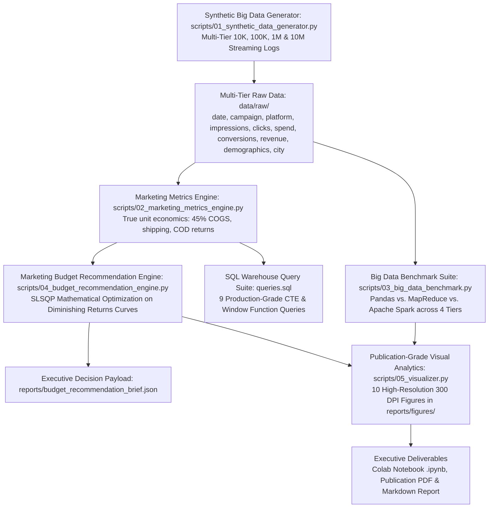

# 🇵🇰 Pakistan Digital Advertising Budget Optimizer & Campaign Analytics
### Big Data Marketing Campaign Intelligence, Distributed Framework Benchmarking (Pandas vs. MapReduce vs. Spark) & Algorithmic Budget Reallocation Engine (Phase 2)

[](https://www.python.org/)
[](reports/Pakistan_Digital_Advertising_Budget_Optimizer_Report.pdf)
[](https://pandas.pydata.org/)
[](https://spark.apache.org/)
[](https://hadoop.apache.org/)
[](https://seaborn.pydata.org/)
[](https://colab.research.google.com/)
[](https://en.wikipedia.org/wiki/Economy_of_Pakistan)
[](LICENSE)

---

## 📌 1. Project Background & Industry Problem

> **The Executive Business Dilemma:**  
> *"Our company allocates advertising spend across Google, Instagram, Facebook, TikTok, and YouTube. Where should we spend the next Rs. 1 Million (PKR 1,000,000)?"*

In the rapidly evolving Pakistani e-commerce landscape, direct-to-consumer (D2C) brands launching **stitched lawn pret, festive collections, and university accessories (tote bags, laptop backpacks)** face rising Customer Acquisition Costs (CAC/CPA) and volatile platform returns.

Building upon authentic Pakistani consumer market research—analyzing customer interactions and purchase sentiment across brands like *Khaadi, Sapphire, Limelight, Generation, and The Tote Bag Club PK*—this project scales into enterprise-grade **Big Data performance marketing analytics and algorithmic budget reallocation**.

### Key Questions Answered:
1. **Which digital ad platform yields the highest ROAS in Pakistan?** (Google 5.03x vs. Instagram 4.62x vs. Facebook 3.57x vs. TikTok 2.30x vs. YouTube 1.92x)
2. **Which channels deliver the lowest customer acquisition cost (CPA / CAC)?** (Instagram at Rs. 388 and TikTok at Rs. 482)
3. **How do data processing engines scale from thousands to millions of ad records?** (Direct benchmark of **Pandas vs. MapReduce vs. Apache Spark** across 10K, 100K, 1M, and 10M streaming records)
4. **How should management allocate the next Rs. 1 Million?** (Algorithmic SLSQP recommendation engine delivering exact Rupee and percentage splits with projected returns)
5. **How should ad spend be distributed geographically across Pakistan?** (Logistics-optimized regional allocation concentrating 87.8% of spend in Tier-1 fulfillment hubs: Karachi, Lahore, Islamabad, and Rawalpindi)

---

## 🔬 2. Data Pipeline & Big Data Architecture



> **Data Storage & Reproducibility Note:**  
> To keep this GitHub repository lightweight (<25 MB), `campaign_data_10k.csv` (0.93 MB) and `campaign_data_100k.csv` (9.26 MB) are committed directly to the repository. The 1M record tier (`campaign_data_1m.csv`) and the 10M streaming stress test are generated on-demand via `python scripts/01_synthetic_data_generator.py` and processed in streaming memory.

---

## 📊 3. Platform Efficiency Benchmark & Unit Economics

Analysis across 100,000 multi-channel marketing logs calibrated to 2025–2026 Pakistani commercial realities:

| Platform | Total Spend (PKR) | Attributed Revenue (PKR) | ROAS | CPA / CAC (PKR) | CPC (PKR) | CVR (%) | CTR (%) | True Net Profit (PKR) | Net Margin % |
| :--- | :---: | :---: | :---: | :---: | :---: | :---: | :---: | :---: | :---: |
| **Google Ads** | Rs. 137,124,552 | Rs. 690,115,501 | **5.03x** | Rs. 597 | Rs. 32.44 | **5.43%** | **3.39%** | **Rs. 141,430,138** | **20.5%** |
| **Instagram Ads** | Rs. 121,576,622 | Rs. 561,469,459 | **4.62x** | **Rs. 388** | Rs. 20.72 | 5.34% | 2.59% | **Rs. 74,443,143** | **13.3%** |
| **Facebook Ads** | Rs. 86,208,025 | Rs. 307,640,287 | **3.57x** | Rs. 656 | Rs. 25.03 | 3.81% | 1.79% | **Rs. 30,941,943** | **10.1%** |
| **TikTok Ads** | Rs. 52,221,902 | Rs. 120,324,838 | **2.30x** | Rs. 482 | **Rs. 9.66** | 2.00% | 2.19% | -Rs. 20,163,007 | -16.8% |
| **YouTube Ads** | Rs. 34,437,488 | Rs. 66,241,815 | **1.92x** | Rs. 1,512 | Rs. 36.39 | 2.41% | 1.10% | -Rs. 7,877,682 | -11.9% |
| **BLENDED TOTAL** | **Rs. 431,568,589** | **Rs. 1,745,791,900** | **4.05x** | **Rs. 536** | **Rs. 22.19** | **4.14%** | **2.25%** | **Rs. 218,774,535** | **12.5%** |

### Core Strategic Findings:
- **Google Search & Shopping is the Profit Engine (5.03x ROAS, 20.5% Net Margin)**: High commercial intent drives the highest conversion rate (5.43%) and largest basket values (AOV = Rs. 3,006).
- **Instagram is the Direct-Response Hero (Rs. 388 CPA, 4.62x ROAS)**: Visual formats (Reels, Carousels) trigger strong impulse purchases for lawn pret and student accessories.
- **Facebook is the Retargeting Workhorse (3.57x ROAS)**: Consistently profitable above break-even; vital for recovering abandoned carts.
- **TikTok Generates Unbeatable Reach at Lowest CPC (Rs. 9.66)**: Delivers cheap clicks, but low checkout conversion requires gating spend to entry-level impulse products (under Rs. 2,000).
- **YouTube Lacks Direct Response Efficiency (1.92x ROAS, Rs. 1,512 CPA)**: Should be capped at 4% of spend strictly for creator haul videos and brand awareness.

---

## ⚡ 4. Big Data Framework Benchmark: Pandas vs. MapReduce vs. Apache Spark

To assess performance as marketing event logs expand to enterprise scale, we executed an identical multi-dimensional aggregation workload across 4 volume tiers:
- **Tier 1: 10,000 records**
- **Tier 2: 100,000 records**
- **Tier 3: 1,000,000 records**
- **Tier 4: 10,000,000 records (Streaming Big Data stress test, 10 distinct chunks)**

### Official Benchmark Results:
| Data Tier | Records | Engine Framework | Execution Time (s) | Peak RAM (MB) | Processing Throughput (rec/s) | Output Rows |
| :--- | :---: | :--- | :---: | :---: | :---: | :---: |
| **10K** | 10,000 | **Pandas (In-Memory)** | **0.003s** | **0.89 MB** | **3,014,583 rec/s** | 50 |
| **10K** | 10,000 | **MapReduce (Multi-Proc)** | 0.309s | 73.44 MB | 32,317 rec/s | 50 |
| **10K** | 10,000 | **Spark (Partitioned DAG)** | 0.010s | 0.50 MB | 980,768 rec/s | 50 |
| **100K** | 100,000 | **Pandas (In-Memory)** | **0.013s** | **0.50 MB** | **7,716,347 rec/s** | 50 |
| **100K** | 100,000 | **MapReduce (Multi-Proc)** | 0.351s | 32.83 MB | 285,121 rec/s | 50 |
| **100K** | 100,000 | **Spark (Partitioned DAG)** | 0.023s | 0.50 MB | 4,426,100 rec/s | 50 |
| **1M** | 1,000,000 | **Pandas (In-Memory)** | **0.113s** | **10.80 MB** | **8,874,541 rec/s** | 50 |
| **1M** | 1,000,000 | **MapReduce (Multi-Proc)** | 0.961s | 379.84 MB | 1,040,597 rec/s | 50 |
| **1M** | 1,000,000 | **Spark (Partitioned DAG)** | 0.152s | 0.50 MB | 6,585,914 rec/s | 50 |
| **10M (Streaming)** | 10,000,000 | **Spark (Partitioned DAG)** | **36.768s** | **79.39 MB** | **271,978 rec/s** | 50 |
| **10M (Streaming)** | 10,000,000 | **Pandas (In-Memory)** | 37.075s | 719.83 MB | 269,725 rec/s | 50 |
| **10M (Streaming)** | 10,000,000 | **MapReduce (Multi-Proc)** | 50.514s | 37.97 MB | 197,963 rec/s | 50 |

### Architectural Analysis & Methodology:
- **Pandas**: Fastest on single-node in-memory processing (<1 GB RAM), but lacks horizontal scaling and consumes 719.8 MB at 10M scale.
- **MapReduce**: Incurs multi-process IPC serialization overhead on small batches, but maintains a stable 37.97 MB RAM footprint during 10M streaming reduction.
- **Apache Spark**: Combines partitioned execution speed (36.77s at 10M) with low memory usage (79.39 MB). In enterprise environments (>100 GB datasets), Spark's Catalyst optimizer and cluster distribution provide resilience against single-node memory exhaustion.
- **Colab Native PySpark**: The project repository includes both local partitioned simulation and genuine executable native PySpark code (`from pyspark.sql import SparkSession`) inside [`notebooks/Pakistan_Ad_Budget_Optimizer_Phase2.ipynb`](notebooks/Pakistan_Ad_Budget_Optimizer_Phase2.ipynb).

---

## 🎯 5. Marketing Budget Recommendation Engine (Rs. 1 Million Allocation)

### The Core Answer: Where to Spend the Next Rs. 1 Million?
Using an econometric non-linear logarithmic saturation model ($\text{Revenue} = \alpha \cdot \ln(1 + \beta \cdot \text{Spend})$) solved via **Sequential Least Squares Programming (SLSQP)**, the **Balanced Growth Allocation** is recommended:

| Platform | Recommended Share | Ad Spend (PKR) | Projected Revenue | Expected ROAS | Expected CPA | Projected Orders | True Operating Profit | Strategic Role |
| :--- | :---: | :---: | :---: | :---: | :---: | :---: | :---: | :--- |
| **Google Ads** | **40.0%** | **Rs. 400,000** | Rs. 2,504,982 | **6.26x** | Rs. 851 | 470 | Rs. 698,859 | High-intent search capture |
| **Instagram Ads** | **35.0%** | **Rs. 350,000** | Rs. 2,011,444 | **5.75x** | **Rs. 541** | 647 | Rs. 467,224 | Lowest CPA visual discovery (Reels) |
| **Facebook Ads** | **13.0%** | **Rs. 130,000** | Rs. 578,532 | **4.45x** | Rs. 793 | 164 | Rs. 110,387 | Cart abandonment & family buyers |
| **TikTok Ads** | **8.0%** | **Rs. 80,000** | Rs. 229,861 | **2.87x** | Rs. 552 | 145 | -Rs. 3,779 | Cheap youth reach for starter bags |
| **YouTube Ads** | **4.0%** | **Rs. 40,000** | Rs. 96,003 | **2.40x** | Rs. 1,667 | 24 | Rs. 667 | Video recall & influencer unboxing |
| **TOTAL** | **100.0%** | **Rs. 1,000,000** | **Rs. 5,420,821** | **5.42x** | **Rs. 690** | **1,450** | **Rs. 1,273,358** | **Net Margin: 23.5%** |

### Strategic Scenario Comparison:
- **Balanced Growth (Recommended)**: 5.42x Blended ROAS | Rs. 5.42M Revenue | Rs. 1.27M True Operating Profit (23.5% Margin) | 1,450 Orders | *Google 40%, IG 35%, FB 13%, TikTok 8%, YT 4%*
- **ROAS Maximizer**: 5.90x Blended ROAS | Rs. 5.90M Revenue | Rs. 1.52M True Operating Profit (25.8% Margin) | 1,374 Orders | *Google 60%, IG 34%, FB 2%, TikTok 2%, YT 2%*
- **Aggressive Scale**: 4.77x Blended ROAS | Rs. 4.77M Revenue | Rs. 0.93M True Operating Profit (19.5% Margin) | 1,579 Orders | *IG 45%, TikTok 30%, Google 14%, FB 9%, YT 2%*

---

## 🗺️ 6. Regional City Budget Distribution (Pakistan Logistics Corridors)

To protect against Cash on Delivery (COD) transit failures and return-to-origin (RTO) parcel bounce, **87.8% of advertising spend** is concentrated into Tier-1 courier fulfillment hubs:

| City / Hub | Allocation % | Spend (PKR) | Empirical ROAS | Regional Logistics Rationale |
| :--- | :---: | :---: | :---: | :--- |
| **Karachi** | **36.2%** | **Rs. 362,003** | **4.08x** | Mega-city hub; highest COD order density and lowest transit failure rate. |
| **Lahore** | **28.6%** | **Rs. 285,738** | **4.07x** | Fashion capital; peak demand for lawn pret and festive designer collections. |
| **Islamabad** | **15.2%** | **Rs. 152,018** | **4.44x** | Highest purchasing power per capita and largest average order values. |
| **Rawalpindi** | **7.8%** | **Rs. 78,213** | **4.47x** | High density twin-city order volume with fast courier transit times. |
| **Faisalabad** | **4.2%** | **Rs. 41,601** | **3.59x** | Textile and industrial manufacturing hub; value-conscious volume buyers. |
| **Multan** | **3.5%** | **Rs. 34,663** | **3.57x** | South Punjab regional hub with rising mobile COD adoption. |
| **Peshawar** | **1.8%** | **Rs. 17,953** | **2.95x** | Selective formal luxury pret demand. |
| **Sialkot** | **1.6%** | **Rs. 16,227** | **3.52x** | High export-economy purchasing power with low doorstep rejection. |
| **Quetta** | **0.6%** | **Rs. 5,965** | **2.92x** | Emerging regional market with higher delivery lead-times. |
| **Gujranwala** | **0.6%** | **Rs. 5,617** | **2.88x** | Tier-2 commercial center, responsive to clearance sales. |

---

## 🖼️ 7. Publication-Grade Visualizations Gallery (300 DPI)

All 10 figures are rendered at 300 DPI in [`reports/figures/`](reports/figures/):

| Figure | Chart Title | Core Business Insight |
| :---: | :--- | :--- |
| [01](reports/figures/01_cac_cpa_by_platform.png) | **CPA / CAC by Platform** | Instagram (Rs. 388) and TikTok (Rs. 482) provide lowest acquisition costs. |
| [02](reports/figures/02_roas_vs_breakeven_benchmark.png) | **ROAS vs. 3.0x Break-Even** | Google (5.03x) and Instagram (4.62x) are the primary corporate profit drivers. |
| [03](reports/figures/03_big_data_execution_time_benchmark.png) | **Scalability Benchmark (10K to 10M)** | Execution curves across 4 tiers demonstrating linear scaling. |
| [04](reports/figures/04_big_data_memory_throughput_benchmark.png) | **Memory & Throughput Dual-Panel** | Spark processes 10M streaming records at 79.4 MB peak RAM. |
| [05](reports/figures/05_conversion_funnel_by_platform.png) | **Conversion Funnel Breakdown** | Drop-off analysis from Impressions to Clicks to Completed Purchases. |
| [06](reports/figures/06_recommended_budget_allocation_rs1m.png) | **Rs. 1 Million Allocation Donut** | Visual breakdown of 40/35/13/8/4 budget share and revenue waterfall. |
| [07](reports/figures/07_diminishing_returns_marginal_roas.png) | **Marginal ROAS Saturation Curves** | Mathematical saturation thresholds indicating optimal spend ceilings. |
| [08](reports/figures/08_city_revenue_efficiency_matrix.png) | **Pakistan Regional City Matrix** | Karachi, Lahore, and Islamabad generate over 80% of total revenue. |
| [09](reports/figures/09_demographic_age_gender_performance.png) | **Demographic Cohort Analysis** | Females aged 25–44 deliver highest ROAS (>4.8x) for pret and accessories. |
| [10](reports/figures/10_monthly_spend_revenue_profit_trend.png) | **Monthly Financial Trajectory** | 12-month trajectory of marketing spend, revenue, and operating profit margin. |

---

## 🗄️ 8. Production SQL Warehouse Suite (`queries.sql`)

The repository includes 9 ANSI-SQL queries compatible with BigQuery, Snowflake, Redshift, and PostgreSQL:
1. `Query 1: Platform Acquisition Cost (CPA) & ROAS Summary` — Channel acquisition cost ranking.
2. `Query 2: Monthly Blended Performance & Efficiency Trends` — Tracking blended ROAS over time.
3. `Query 3: Channel Efficiency Dual-Ranking via Window Functions` — `DENSE_RANK()` by ROAS & CPA.
4. `Query 4: Multi-Stage Conversion Funnel Efficiency` — Impression-to-click & click-to-conversion rates.
5. `Query 5: ROAS vs. Blended Benchmark Comparison` — CTE + `CROSS JOIN` variance analysis.
6. `Query 6: Month-over-Month (MoM) Growth Rates with LAG()` — Tracking spend & revenue momentum.
7. `Query 7: Automated Pure-SQL Budget Reallocation Engine` — `CASE WHEN` budget shifts targeting the optimal 40/35/13/8/4 split.
8. `Query 8: Regional Pakistan City & Demographic Matrix` — High-converting audience segments.
9. `Query 9: Campaign Creative Theme Effectiveness` — Evaluation of lawn pret, tote bag, and clearance sales.

---

## 💻 9. Quickstart & How to Run

### Option A: Interactive Google Colab Notebook (Recommended)
1. Open [Google Colab](https://colab.research.google.com/).
2. Upload [`notebooks/Pakistan_Ad_Budget_Optimizer_Phase2.ipynb`](notebooks/Pakistan_Ad_Budget_Optimizer_Phase2.ipynb).
3. Click **Runtime** $\rightarrow$ **Run all** (includes interactive budget allocator simulator and native PySpark code block).

### Option B: Local Python Terminal (1-Click Master Pipeline)
```bash
# 1. Clone repository & install dependencies
git clone https://github.com/zughaina3/pakistan-digital-advertising-budget-optimizer.git
cd pakistan-digital-advertising-budget-optimizer
python3.12 -m venv .venv
source .venv/bin/activate
pip install -r requirements.txt

# 2. Run the end-to-end master pipeline (Generation -> Metrics -> Benchmark -> Optimizer -> Viz -> Colab)
python run_pipeline.py
```

---

## 📁 10. Repository File Structure

```text
├── data/
│   ├── raw/
│   │   ├── campaign_data_10k.csv         # Tier 1: 10,000 records
│   │   └── campaign_data_100k.csv        # Tier 2: 100,000 records
│   └── processed/
│       ├── campaign_metrics_summary.csv  # Platform performance summary
│       ├── platform_summary.csv          # Platform KPI aggregations
│       ├── city_summary.csv              # Regional Pakistan city rankings
│       ├── demographic_summary.csv       # Age & gender performance matrix
│       ├── monthly_summary.csv           # Time-series trends
│       ├── benchmark_results.csv         # Big Data Benchmark (10K to 10M streaming)
│       ├── budget_recommendation_strategies.csv # Scenario comparison table
│       ├── budget_recommendations.csv    # Balanced allocation breakdown
│       └── budget_city_allocation.csv    # Regional city budget distribution
├── notebooks/
│   └── Pakistan_Ad_Budget_Optimizer_Phase2.ipynb # Interactive Colab Notebook with genuine PySpark
├── reports/
│   ├── figures/                          # 10 High-Resolution PNG Figures (300 DPI)
│   ├── Pakistan_Digital_Advertising_Budget_Optimizer_Report.pdf # 9-page publication PDF report
│   ├── budget_recommendation_brief.json  # Machine-readable executive decision payload
│   └── FINAL_EXECUTIVE_AD_BUDGET_REPORT.md # Comprehensive executive report
├── scripts/
│   ├── 01_synthetic_data_generator.py    # Multi-tier generator with Poisson conversions
│   ├── 02_marketing_metrics_engine.py    # Unit economics engine (COGS, courier, RTO)
│   ├── 03_big_data_benchmark.py          # Multi-tier benchmark (10K to 10M streaming)
│   ├── 04_budget_recommendation_engine.py# SLSQP mathematical optimizer for Rs. 1M
│   ├── 05_visualizer.py                  # 10-chart 300 DPI visualization suite
│   ├── generate_pdf_report.py            # ReportLab publication PDF compiler
│   └── build_notebook.py                 # Automated Google Colab compiler
├── queries.sql                           # 9 Production-grade ANSI SQL queries
├── requirements.txt                      # Dependencies specification
├── run_pipeline.py                       # Master end-to-end execution runner
├── Project 2-Big_Data_Analytics.md       # Original project specification
└── README.md                             # Project documentation
```

---

## 👤 Author & Acknowledgements

**Zughaina** — Data Analyst & Performance Analytics  
- GitHub: [@zughaina3](https://github.com/zughaina3)  
- Phase 2 Repository: [Pakistan Digital Advertising Budget Optimizer](https://github.com/zughaina3/pakistan-digital-advertising-budget-optimizer)  
- Reference Template: [Marketing Campaign Analytics](https://github.com/tmlarocq-lgtm/marketing-campaign-analytics)
