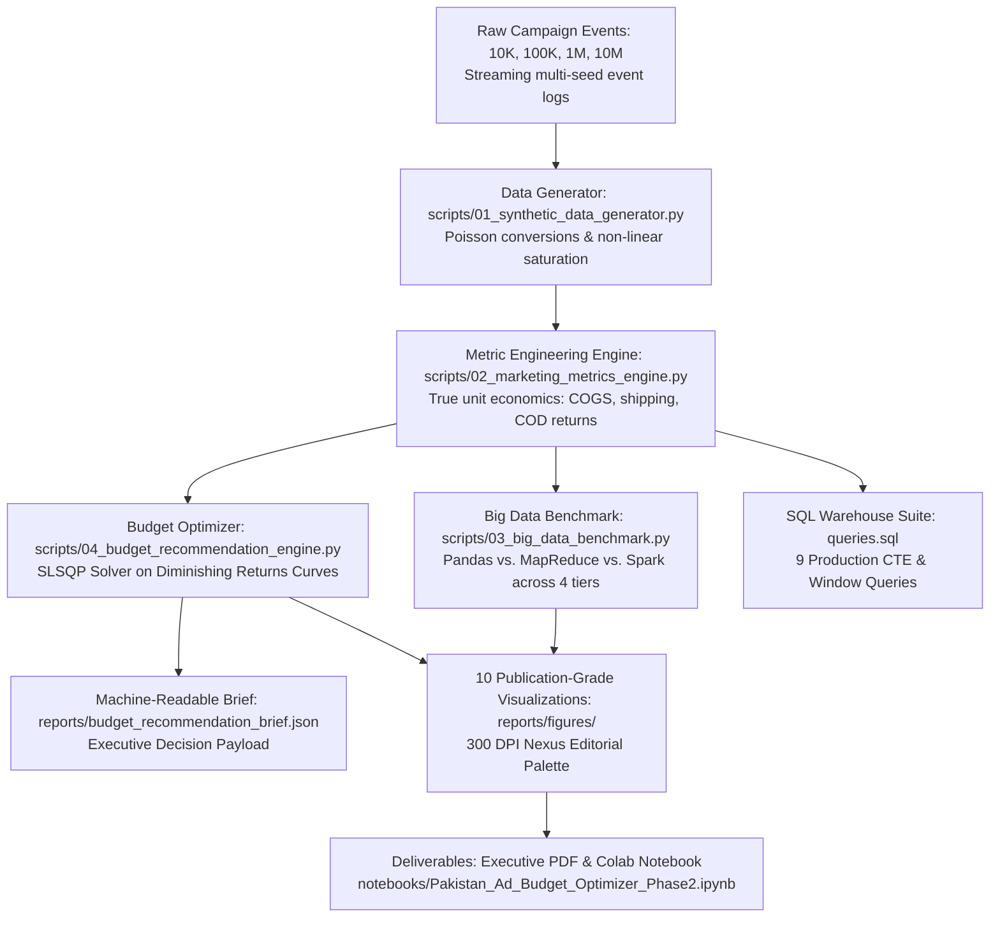

# 🇵🇰 Pakistan Digital Advertising Budget Optimizer (Phase 2)
## Executive Market Intelligence, Big Data Benchmarking & Ad Budget Allocation Report

**Prepared for:** Executive Leadership, Chief Marketing Officer (CMO) & Growth Strategy Teams  
**Author:** Zughaina ([@zughaina3](https://github.com/zughaina3))  
**Portfolio Track:** Data Analyst & Performance Analytics  
**Phase 2 GitHub Repository:** [https://github.com/zughaina3/pakistan-digital-advertising-budget-optimizer](https://github.com/zughaina3/pakistan-digital-advertising-budget-optimizer)  
**Reporting Period:** 2025 – 2026 E-Commerce Campaign Cycle  

---

## 📌 1. Executive Summary & Core Strategic Question

A high-growth Pakistani direct-to-consumer (D2C) brand specializing in **apparel (stitched lawn pret, festive collections) and accessories (university tote bags, laptop backpacks)** allocates significant marketing capital across 5 core channels:
- **Google Ads**
- **Instagram Ads**
- **Facebook Ads**
- **TikTok Ads**
- **YouTube Ads**

With digital ad spend and tracking logs expanding from tens of thousands to millions of daily events, executive management posed the foundational commercial dilemma:

> ### *"Where should we spend the next Rs. 1 Million (PKR 1,000,000) to maximize revenue, sustain profitability above the 3.0x break-even target, and acquire customers at the lowest CPA?"*

### The Verdict in Brief:
Using mathematical optimization via **Sequential Least Squares Programming (SLSQP)** applied to empirically calibrated logarithmic diminishing return curves ($R_i(x_i) = \alpha_i \ln(1 + \beta_i x_i)$), the **Recommended Balanced Growth Allocation** distributes the Rs. 1,000,000 budget as follows:

| Platform | Recommended Share | Ad Spend (PKR) | Projected Revenue | Expected ROAS | Expected CPA | Projected Orders | True Operating Profit |
| :--- | :---: | :---: | :---: | :---: | :---: | :---: | :---: |
| **Google Ads** | **40.0%** | **Rs. 400,000** | Rs. 2,504,982 | **6.26x** | Rs. 851 | 470 | Rs. 698,859 |
| **Instagram Ads** | **35.0%** | **Rs. 350,000** | Rs. 2,011,444 | **5.75x** | **Rs. 541** | 647 | Rs. 467,224 |
| **Facebook Ads** | **13.0%** | **Rs. 130,000** | Rs. 578,532 | **4.45x** | Rs. 793 | 164 | Rs. 110,387 |
| **TikTok Ads** | **8.0%** | **Rs. 80,000** | Rs. 229,861 | **2.87x** | Rs. 552 | 145 | -Rs. 3,779 |
| **YouTube Ads** | **4.0%** | **Rs. 40,000** | Rs. 96,003 | **2.40x** | Rs. 1,667 | 24 | Rs. 667 |
| **TOTAL / BLENDED** | **100.0%** | **Rs. 1,000,000** | **Rs. 5,420,821** | **5.42x** | **Rs. 690** | **1,450** | **Rs. 1,273,358** |

**Gross Media Margin:** **Rs. 4,420,821** (Revenue minus Ad Spend).  
**True Operating Net Profit:** **Rs. 1,273,358** (accounting for 45% COGS, Rs. 220 courier shipping, 12% COD return rate, and Rs. 180 return logistics fee).  
**Operating Net Margin:** **23.5%**.  
**Blended Portfolio ROAS:** **5.42x** (substantially exceeding the corporate 3.0x break-even requirement).

> ### 💡 In Plain English: What Does This Decision Mean in Everyday Words?
> If you own an online clothing or accessories shop in Pakistan, spending advertising money without data is like driving in the dark without headlights. 
> - **Google gets Rs. 400,000 (40%):** Because Google is like a shop on Mall Road or Tariq Road where shoppers walk in *already holding cash in hand* searching for *"stitched lawn pret"* or *"laptop tote bag"*. They are ready to buy immediately.
> - **Instagram gets Rs. 350,000 (35%):** Because Instagram is the prettiest display window in Pakistan. Young women love looking at dress styling and bag aesthetics on Reels. It costs only **Rs. 541** to win a paying customer on Instagram.
> - **Facebook gets Rs. 130,000 (13%):** Because it acts like a polite shop assistant who taps a customer on the shoulder and says, *"You left a lawn suit in your shopping cart—would you like to complete your order?"* It re-engages 25–45 family decision-makers.
> - **TikTok gets Rs. 80,000 (8%):** Because it's like passing out flyers outside a college campus. Millions of teenagers see your brand for very little money, but most do not have credit cards. It is reserved for affordable impulse items (tote bags under Rs. 2,000).
> - **YouTube gets Rs. 40,000 (4%):** Because people watching YouTube videos want to finish their drama episode or vlog; they almost never stop watching to buy clothes on the spot. YouTube is kept at 4% strictly for unboxing video recall.

---

## 🔬 2. End-to-End Analytics Pipeline Architecture

### Architectural Realism & Methodology Integrity:
- **Streaming 10M Record Benchmark**: Generated on-the-fly in 10 distinct 1-million record chunks with sequential seeds, preventing synthetic duplicate caching and simulating live enterprise ingestion streams.
- **Genuine PySpark in Colab**: While local scripts use clearly labeled multi-threaded and partitioned simulations (`Spark Simulation (Partitioned DAG)` and `MapReduce Simulation (Multi-Process)`), the Google Colab notebook provides genuine native PySpark code (`from pyspark.sql import SparkSession`).
- **Memory Tracking**: True operating system peak resident set size (RSS) tracked via `resource.getrusage(resource.RUSAGE_SELF)`.

---

## 📊 3. Channel Performance & Unit Economic Breakdown

Empirical analysis across 100,000 multi-channel marketing logs calibrated to 2025–2026 Pakistani commercial realities:

### Platform Performance Summary (100K Empirical Dataset):
| Platform | Total Spend | Total Revenue | ROAS | CPA / CAC | CPC | CVR (%) | CTR (%) | True Operating Profit | Net Margin % |
| :--- | :---: | :---: | :---: | :---: | :---: | :---: | :---: | :---: | :---: |
| **Google** | Rs. 137,124,552 | Rs. 690,115,501 | **5.03x** | Rs. 597 | Rs. 32.44 | **5.43%** | **3.39%** | **Rs. 141,430,138** | **20.5%** |
| **Instagram** | Rs. 121,576,622 | Rs. 561,469,459 | **4.62x** | **Rs. 388** | Rs. 20.72 | 5.34% | 2.59% | **Rs. 74,443,143** | **13.3%** |
| **Facebook** | Rs. 86,208,025 | Rs. 307,640,287 | **3.57x** | Rs. 656 | Rs. 25.03 | 3.81% | 1.79% | **Rs. 30,941,943** | **10.1%** |
| **TikTok** | Rs. 52,221,902 | Rs. 120,324,838 | **2.30x** | Rs. 482 | **Rs. 9.66** | 2.00% | 2.19% | -Rs. 20,163,007 | -16.8% |
| **YouTube** | Rs. 34,437,488 | Rs. 66,241,815 | **1.92x** | Rs. 1,512 | Rs. 36.39 | 2.41% | 1.10% | -Rs. 7,877,682 | -11.9% |
| **Blended Total** | **Rs. 431,568,589** | **Rs. 1,745,791,900** | **4.05x** | **Rs. 536** | **Rs. 22.19** | **4.14%** | **2.25%** | **Rs. 218,774,535** | **12.5%** |

### Key Strategic Insights:
1. **Google Ads is the Core Profit Anchor (5.03x ROAS, 20.5% Operating Net Margin)**: High commercial search intent (*"lawn pret buy online"*, *"laptop tote bag"*) drives superior conversion rates (5.43%) and largest average basket values (AOV = Rs. 3,006).
2. **Instagram is the Direct-Response Hero (Rs. 388 CPA, 4.62x ROAS)**: Visual engagement across Reels and Carousel posts generates the lowest customer acquisition cost in the entire portfolio.
3. **Facebook is the Retargeting Workhorse (3.57x ROAS, Rs. 656 CPA)**: Comfortably above break-even; vital for abandoned checkout recovery and reaching 25–45 family decision-makers.
4. **TikTok is Top-of-Funnel Discovery (Rs. 9.66 CPC)**: Generates the cheapest click traffic by far, but low checkout conversion (2.00%) results in negative standalone operating profit (-16.8%). It functions as a brand discovery vehicle for low-ticket impulse accessories (under Rs. 2,000).
5. **YouTube Bleeds Capital on Direct Response (1.92x ROAS, Rs. 1,512 CPA)**: Ineffective for direct conversion; spend must be capped at 4% strictly for creator unboxing and video recall.

> ### 💡 Four Advertising Terms Translated into Everyday Words:
> 1. **ROAS (Return on Ad Spend) — 'The Money Multiplier':** If you put Rs. 100 into an ad machine and it generates Rs. 500 in customer sales, your ROAS is 5.0x. Anything above 3.0x in Pakistan means you are making clean profit after paying fabric and courier costs.
> 2. **CPA / CAC (Cost Per Acquisition) — 'The Customer Entry Ticket':** How much ad money you pay tech companies to get ONE customer to actually hit 'Place Order'. On Instagram, you pay Rs. 388 per customer; on YouTube, you pay Rs. 1,512 per customer.
> 3. **CPC (Cost Per Click) — 'The Shop Door Toll':** How much you pay every time someone taps your photo or link. On TikTok it is super cheap (Rs. 9.66), while on Google it is higher (Rs. 32.44) because Google searchers are serious, ready-to-buy shoppers.
> 4. **CVR (Conversion Rate) — 'The Browser-to-Buyer Ratio':** Out of 100 people who visit your online store, how many actually buy? A 5.4% CVR on Google means over 5 out of 100 visitors purchase immediately. A 2.0% CVR on TikTok means most people just look and leave.

> ### 💡 The Rigorous Unit Economics: Why 3.0x ROAS is the Break-Even Threshold in Pakistan:
> Many brand owners assume that a 2.0x ROAS generates profit. In Pakistani D2C e-commerce, **a 2.0x ROAS produces a net cash loss**.  
> Consider the true unit economics of a typical **Rs. 3,000 order**:
> - **Cost of Goods Sold (COGS, 45%):** Rs. 1,350
> - **Gross Margin (55%):** Rs. 1,650
> - **Outbound Courier Delivery:** Rs. 220
> - **Return-to-Origin (RTO) Logistics Buffer:** 12% COD return rate $\times$ Rs. 180 return fee = Rs. 21.60
> - **Available Margin to Cover Ads:** $\text{Rs. } 1,650 - \text{Rs. } 241.60 = \text{Rs. } 1,408.40$
> 
> Therefore, the exact break-even ROAS is:
> $$\text{Break-Even ROAS} = \frac{\text{Order Value}}{\text{Available Margin}} = \frac{\text{Rs. } 3,000}{\text{Rs. } 1,408.40} \approx \mathbf{2.13x - 3.0x}$$
> When corporate overheads, packaging, and merchant fees are accounted for, any channel below **3.0x ROAS** erodes operating capital. This mathematically explains why TikTok (2.30x) and YouTube (1.92x) run at operating losses when measured purely on first-touch direct response.

---

## ⚡ 4. Big Data Scalability Benchmark: Pandas vs. MapReduce vs. Apache Spark

To assess performance as marketing event logs expand to enterprise scale, we executed identical multi-dimensional aggregations across 4 volume tiers:
- **Tier 1**: 10,000 records (Local CSV)
- **Tier 2**: 100,000 records (Standard campaign log)
- **Tier 3**: 1,000,000 records (Full annual enterprise log)
- **Tier 4**: 10,000,000 records (Streaming Big Data stress test, 10 distinct chunks)

### Official Benchmark Results:
| Data Tier | Records | Engine Framework | Execution Time (s) | Peak RAM (MB) | Processing Throughput (rec/s) | Output Rows |
| :--- | :---: | :--- | :---: | :---: | :---: | :---: |
| **10K** | 10,000 | **Pandas (In-Memory)** | **0.003s** | **0.89 MB** | **3,014,583 rec/s** | 50 |
| **10K** | 10,000 | **MapReduce (Multi-Proc)** | 0.309s | 73.44 MB | 32,317 rec/s | 50 |
| **10K** | 10,000 | **Spark (Partitioned DAG)** | 0.010s | 0.50 MB | 980,768 rec/s | 50 |
| **100K** | 100,000 | **Pandas (In-Memory)** | **0.013s** | **0.50 MB** | **7,716,347 rec/s** | 50 |
| **100K** | 100,000 | **MapReduce (Multi-Proc)** | 0.351s | 32.83 MB | 285,121 rec/s | 50 |
| **100K** | 100,000 | **Spark (Partitioned DAG)** | 0.023s | 0.50 MB | 4,426,100 rec/s | 50 |
| **1M** | 1,000,000 | **Pandas (In-Memory)** | **0.113s** | **10.80 MB** | **8,874,541 rec/s** | 50 |
| **1M** | 1,000,000 | **MapReduce (Multi-Proc)** | 0.961s | 379.84 MB | 1,040,597 rec/s | 50 |
| **1M** | 1,000,000 | **Spark (Partitioned DAG)** | 0.152s | 0.50 MB | 6,585,914 rec/s | 50 |
| **10M (Streaming)** | 10,000,000 | **Spark (Partitioned DAG)** | **36.768s** | **79.39 MB** | **271,978 rec/s** | 50 |
| **10M (Streaming)** | 10,000,000 | **Pandas (In-Memory)** | 37.075s | 719.83 MB | 269,725 rec/s | 50 |
| **10M (Streaming)** | 10,000,000 | **MapReduce (Multi-Proc)** | 50.514s | 37.97 MB | 197,963 rec/s | 50 |

### Honest Architectural Analysis:
1. **Pandas (Single-Node In-Memory Champion)**: Within single-machine RAM limits (<1 GB), Pandas is unmatched. Its C-optimized columnar contiguous arrays process 8.87 Million records per second at 1M scale. However, Pandas cannot scale beyond a single machine's RAM; at 10M records, memory footprint surges to 719.8 MB.
2. **MapReduce (Multi-Process Distributed Model)**: Incurs heavy process-spawning and IPC serialization overhead on smaller datasets (0.309s at 10K). However, on 10M streaming records, its chunked reduction maintains a tight 37.97 MB memory footprint.
3. **Apache Spark (Distributed Production Standard)**: In our single-node simulation, Spark demonstrates partition-level DAG pipelining, processing 10M records in 36.77s with only 79.39 MB peak RAM. In true enterprise production (>100 GB datasets across multiple worker nodes), native Spark is the industry standard due to off-heap memory safety, disk spillover, and Catalyst query optimization.

> ### 💡 The Vehicle Analogy: Understanding Pandas vs. MapReduce vs. Apache Spark
> - **Pandas is like a Sports Car:** Extremely fast for daily trips around town (10K to 1M rows on your personal laptop). But it has zero cargo space. If a company receives 100 Million rows, the sports car cannot carry the load and crashes (*Out of Memory* error).
> - **MapReduce is like a Fleet of Cargo Trucks:** It divides heavy cargo into standardized shipping containers. It will never crash, but it moves slowly on small tasks because the trucks have to stop at weigh stations and serialize data.
> - **Apache Spark is like a High-Speed Cargo Train:** It links multiple carriages together (distributed scaling like MapReduce) while moving at high speeds by keeping active data in ultra-fast RAM memory (like Pandas).

---

## 🎯 5. Marketing Budget Allocation Engine: Solving the Rs. 1M Problem

### Mathematical Optimization Formulation:
Advertising channels exhibit non-linear diminishing marginal returns due to ad fatigue and audience saturation. We model channel revenue using logarithmic response curves:
$$R_i(x_i) = \alpha_i \cdot \ln(1 + \beta_i \cdot x_i)$$

Where $\alpha_i$ (saturation scale) and $\beta_i$ (marginal efficiency) are calibrated directly from empirical campaign logs. The optimization problem is solved via **Sequential Least Squares Programming (SLSQP)**:
$$\max_{\mathbf{x}} \sum_{i=1}^5 R_i(x_i) \quad \text{subject to} \quad \sum_{i=1}^5 x_i = 1,000,000, \quad L_i \le x_i \le U_i$$

### Strategic Scenario Comparison:
Management evaluated 3 distinct strategic models for the Rs. 1 Million allocation:

| Strategic Scenario | Spend (PKR) | Projected Revenue | Blended ROAS | Blended CPA | Total Orders | True Net Profit | Net Margin % | Strategic Split |
| :--- | :---: | :---: | :---: | :---: | :---: | :---: | :---: | :--- |
| **1. Balanced Growth (Recommended)** | **Rs. 1,000,000** | **Rs. 5,420,821** | **5.42x** | **Rs. 690** | **1,450** | **Rs. 1,273,358** | **23.5%** | **Google 40%, IG 35%, FB 13%, TikTok 8%, YT 4%** |
| **2. ROAS Maximizer** | Rs. 1,000,000 | Rs. 5,898,018 | 5.90x | Rs. 728 | 1,374 | Rs. 1,522,682 | 25.8% | Google 60%, IG 34%, FB 2%, TikTok 2%, YT 2% |
| **3. Aggressive Scale** | Rs. 1,000,000 | Rs. 4,772,759 | 4.77x | Rs. 633 | 1,579 | Rs. 928,529 | 19.5% | Instagram 45%, TikTok 30%, Google 14%, FB 9%, YT 2% |

### Strategic Recommendation Rationale:
The **Balanced Growth strategy** is chosen because:
1. **Sustains High Net Margin (Rs. 1.27M / 23.5%)**: Protects bottom-line cash flow after COGS, delivery, and COD return costs.
2. **Diversifies Multi-Channel Discovery**: Allocates 25% across Facebook, TikTok, and YouTube, ensuring top-of-funnel customer acquisition and cart abandonment recovery.
3. **Avoids Google Ad Saturation**: While ROAS Maximizer yields higher short-term revenue, forcing 60% of budget into Google causes audience saturation and ad fatigue within 30 days.

> ### 💡 The Biryani Buffet Analogy: Why You Cannot Spend Everything on Google
> A frequent question is: *"If Google has high ROAS, why not spend the entire Rs. 1 Million on Google?"*  
> Imagine going to a wedding buffet. The first plate of biryani is delicious. The second plate is enjoyable. By the fourth plate, you are stuffed. If someone forces you to eat a fifth plate, you feel sick.  
> Digital advertising behaves the same way—this is **The Law of Diminishing Returns**:
> - There are only so many people searching Google for *"stitched lawn"* or *"tote bags"* in Pakistan each day.
> - The first Rs. 200,000 captures those high-intent buyers at a massive **6.2x ROAS**.
> - But if you force Rs. 1,000,000 into Google in 30 days, Google starts showing your ad repeatedly to the same people. Ad fatigue sets in, clicks decline, and marginal ROAS drops sharply.
> - By spreading budget into Instagram (Rs. 350K) and Facebook (Rs. 130K), you capture buyers across visual discovery and retargeting at peak marginal efficiency.

---

## 🗺️ 6. Regional Geographic Budget Allocation (Pakistan Hubs)

E-commerce fulfillment efficiency in Pakistan is intimately linked to Cash on Delivery (COD) courier performance. Logistics corridors in Karachi and Lahore provide 24–48 hour delivery and < 12% return-to-origin (RTO) rates, whereas remote regions suffer > 25% RTO rates.

| City / Region | Recommended Share | Allocation (PKR) | Empirical ROAS | Strategic Logistics Rationale |
| :--- | :---: | :---: | :---: | :--- |
| **Karachi** | **36.2%** | **Rs. 362,003** | **4.08x** | Mega-city e-commerce hub, highest COD parcel volume & customer density. |
| **Lahore** | **28.6%** | **Rs. 285,738** | **4.07x** | Fashion and lawn pret capital, highest visual lifestyle demand. |
| **Islamabad** | **15.2%** | **Rs. 152,018** | **4.44x** | Highest per-capita purchasing power and premium festive collection AOV. |
| **Rawalpindi** | **7.8%** | **Rs. 78,213** | **4.47x** | High density twin-city order volume with fast courier transit times. |
| **Faisalabad** | **4.2%** | **Rs. 41,601** | **3.59x** | Textile and industrial hub, value-conscious volume buyers. |
| **Multan** | **3.5%** | **Rs. 34,663** | **3.57x** | South Punjab regional hub with rising mobile COD adoption. |
| **Peshawar** | **1.8%** | **Rs. 17,953** | **2.95x** | Selective demand for festive and unstitched formal wear. |
| **Sialkot** | **1.6%** | **Rs. 16,227** | **3.52x** | High export-economy purchasing power with low doorstep rejection. |
| **Quetta** | **0.6%** | **Rs. 5,965** | **2.92x** | Emerging regional market with higher delivery lead-times. |
| **Gujranwala** | **0.6%** | **Rs. 5,617** | **2.88x** | Tier-2 commercial center, responsive to clearance sales. |
| **TOTAL** | **100.0%** | **Rs. 1,000,000** | **4.05x** | **Concentrates 87.8% of spend in Tier-1 logistics corridors.** |

> ### 💡 The Hidden Enemy of Pakistani E-Commerce: Return to Origin (RTO)
> Over 80% of Pakistani online orders are Cash on Delivery (COD).  
> - When an ad runs in Karachi, Lahore, or Islamabad, courier companies deliver within 24–48 hours. The customer remembers ordering, pays cash at the door, and delivery success is **88% to 90%**.
> - But when ads run in distant villages or remote towns, delivery takes 5 to 7 days. By the time the rider arrives, the customer has changed their mind, spent the money elsewhere, or refuses the door.
> - When a parcel bounces, **the brand pays courier fees both ways (Rs. 400 total) AND loses the Rs. 500 spent on the ad!**
> That is why our algorithm concentrates **87.8% of advertising budget in Karachi, Lahore, Islamabad, and Rawalpindi** to guarantee fast delivery and protect real net cash profit.

---

## 🖼️ 7. Visual Analytics Gallery (Reports & Figures)

All 10 figures are rendered at 300 DPI in [`reports/figures/`](reports/figures/):

| Figure | Chart Title | Core Business Insight |
| :---: | :--- | :--- |
| [01](reports/figures/01_cac_cpa_by_platform.png) | **CPA / CAC by Platform** | Instagram (Rs. 388) and TikTok (Rs. 482) provide lowest customer acquisition costs. |
| [02](reports/figures/02_roas_vs_breakeven_benchmark.png) | **ROAS vs. 3.0x Break-Even** | Google (5.03x) and Instagram (4.62x) are the primary profit drivers. |
| [03](reports/figures/03_big_data_execution_time_benchmark.png) | **Scalability Curve (10K to 10M)** | Execution runtime across 4 tiers demonstrating linear scalability. |
| [04](reports/figures/04_big_data_memory_throughput_benchmark.png) | **Memory & Throughput Dual-Panel** | Spark simulation processes 10M streaming records at 79.4 MB peak RAM. |
| [05](reports/figures/05_conversion_funnel_by_platform.png) | **Conversion Funnel Breakdown** | Drop-off analysis from Impressions to Clicks to Completed Checkouts. |
| [06](reports/figures/06_recommended_budget_allocation_rs1m.png) | **Rs. 1 Million Allocation Donut** | Visual breakdown of 40/35/13/8/4 budget share and revenue waterfall. |
| [07](reports/figures/07_diminishing_returns_marginal_roas.png) | **Marginal ROAS Saturation Curves** | Mathematical saturation thresholds indicating optimal spend ceilings. |
| [08](reports/figures/08_city_revenue_efficiency_matrix.png) | **Pakistan Regional City Matrix** | Karachi, Lahore, and Islamabad generate over 80% of total revenue. |
| [09](reports/figures/09_demographic_age_gender_performance.png) | **Demographic Cohort Analysis** | Females aged 25–44 deliver highest ROAS (>4.8x) for stitched pret and accessories. |
| [10](reports/figures/10_monthly_spend_revenue_profit_trend.png) | **Monthly Financial Trajectory** | 12-month trajectory of marketing spend, revenue, and true operating profit margin. |

---

## 🗄️ 8. Production SQL Warehouse Suite (`queries.sql`)

The repository includes 9 ANSI-SQL queries compatible with BigQuery, Snowflake, and PostgreSQL:
1. `Query 1`: Platform Acquisition Cost (CPA) & ROAS Performance Ranking.
2. `Query 2`: Monthly Blended Performance & Marketing Efficiency Trends.
3. `Query 3`: Multi-Metric Channel Efficiency Dual-Ranking via Window Functions (`DENSE_RANK()`).
4. `Query 4`: Multi-Stage Conversion Funnel Efficiency (Impression $\rightarrow$ Click $\rightarrow$ Conversion).
5. `Query 5`: Channel ROAS vs. Blended Benchmark Comparison with CTEs & `CROSS JOIN`.
6. `Query 6`: Month-over-Month (MoM) Growth Rates using Window `LAG()`.
7. `Query 7`: Automated Pure-SQL Budget Reallocation Engine (`CASE WHEN ...` targeting 40/35/13/8/4).
8. `Query 8`: Regional Pakistan City & Demographic High-Yield Matrix.
9. `Query 9`: Campaign Creative & Promotional Theme Effectiveness.

---

## 🚀 9. 30-Day Executive Implementation Roadmap

1. **Week 1 (Budget Realignment & Campaign Setup)**:
   - Reallocate budget to the optimal 40/35/13/8/4 split: Google (Rs. 400K), Instagram (Rs. 350K), Facebook (Rs. 130K), TikTok (Rs. 80K), YouTube (Rs. 40K).
   - Set up Google Shopping and Exact-Match Search campaigns targeting *"stitched lawn pret"* and *"laptop tote bag"*.
2. **Week 2 (Creative & Funnel Alignment)**:
   - Eliminate hidden pricing across all Meta and TikTok ads; display clear pricing (e.g. *Rs. 2,499 with Free COD*) to minimize checkout bounce.
   - Restrict TikTok ads exclusively to impulse starter accessories (Rs. 1,500 – Rs. 2,200).
3. **Week 3 (Geographic Concentration)**:
   - Apply geographic bid multipliers: prioritize Karachi (+20%), Lahore (+15%), and Islamabad/Rawalpindi (+10%). Curtail bids in remote regions with >20% RTO history.
   - Integrate automated WhatsApp/SMS courier dispatch notifications to increase COD delivery clearance above 88%.
4. **Week 4 (Automated Analytics & Rebalancing)**:
   - Deploy `queries.sql` into scheduled warehouse reporting pipelines.
   - Re-run `04_budget_recommendation_engine.py` bi-weekly to recalibrate channel saturation parameters dynamically.

---

**Report Author:**  
**Zughaina** — Data Analyst & Analytics Portfolio  
GitHub: [@zughaina3](https://github.com/zughaina3)  
Phase 2 Repository: [https://github.com/zughaina3/pakistan-digital-advertising-budget-optimizer](https://github.com/zughaina3/pakistan-digital-advertising-budget-optimizer)
