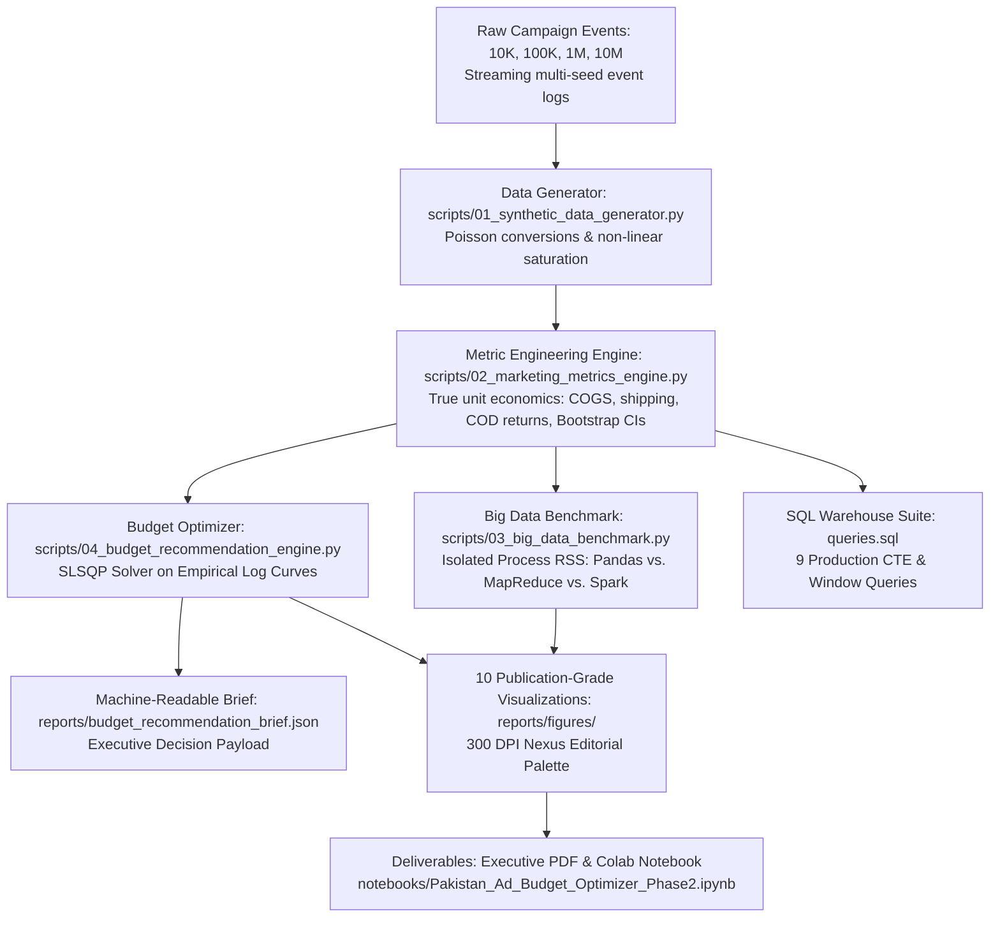

# 🇵🇰 Pakistan Digital Advertising Budget Optimizer (Phase 2)
## Executive Market Intelligence, Big Data Benchmarking & Ad Budget Allocation Report

**Prepared for:** Executive Leadership, Chief Marketing Officer (CMO) & Growth Strategy Teams  
**Author:** Zughaina ([@zughaina3](https://github.com/zughaina3))  
**Portfolio Track:** Data Analyst & Performance Analytics  
**Phase 2 GitHub Repository:** [https://github.com/zughaina3/pakistan-digital-advertising-budget-optimizer](https://github.com/zughaina3/pakistan-digital-advertising-budget-optimizer)  
**Reporting Period:** 2025 – 2026 E-Commerce Campaign Cycle  

---

## 📌 1. Executive Summary & Core Strategic Question

A high-growth Pakistani direct-to-consumer (D2C) brand specializing in **apparel (stitched lawn pret, festive collections) and accessories (university tote bags, laptop backpacks)** allocates significant marketing capital across 5 core channels:
- **Google Ads**
- **Instagram Ads**
- **Facebook Ads**
- **TikTok Ads**
- **YouTube Ads**

With digital ad spend and tracking logs expanding from tens of thousands to millions of daily events, executive management posed the foundational commercial dilemma:

> ### *"Where should we spend the next Rs. 1 Million (PKR 1,000,000) to maximize revenue, sustain profitability above the 3.0x break-even target, and acquire customers at the lowest CPA?"*

### The Verdict in Brief:
Using mathematical optimization via **Sequential Least Squares Programming (SLSQP)** applied to logarithmic diminishing return curves ($R_i(x_i) = \alpha_i \ln(1 + \beta_i x_i)$) calibrated directly from historical daily data via `scipy.optimize.curve_fit`, the **Recommended Balanced Growth Allocation** distributes the Rs. 1,000,000 budget as follows:

| Platform | Recommended Share | Ad Spend (PKR) | Projected Revenue | Expected ROAS | Expected CPA | Projected Orders | True Operating Profit |
| :--- | :---: | :---: | :---: | :---: | :---: | :---: | :---: |
| **Google Ads** | **40.0%** | **Rs. 400,000** | Rs. 2,006,579 | **5.02x** | Rs. 600 | 667 | Rs. 410,037 |
| **Instagram Ads** | **35.0%** | **Rs. 350,000** | Rs. 1,613,177 | **4.61x** | **Rs. 388** | 901 | Rs. 213,096 |
| **Facebook Ads** | **13.0%** | **Rs. 130,000** | Rs. 478,728 | **3.68x** | Rs. 637 | 204 | Rs. 52,418 |
| **TikTok Ads** | **8.0%** | **Rs. 80,000** | Rs. 188,668 | **2.36x** | Rs. 471 | 170 | -Rs. 29,757 |
| **YouTube Ads** | **4.0%** | **Rs. 40,000** | Rs. 80,236 | **2.01x** | Rs. 1,429 | 28 | -Rs. 7,931 |
| **TOTAL / BLENDED** | **100.0%** | **Rs. 1,000,000** | **Rs. 4,367,388** | **4.37x** | **Rs. 508** | **1,970** | **Rs. 637,864** |

**Gross Media Margin:** **Rs. 3,367,388** (Revenue minus Ad Spend).  
**True Operating Net Profit:** **Rs. 637,864** (accounting for 45% COGS, Rs. 220 courier shipping, 12% COD return rate, and Rs. 180 return logistics fee).  
**Operating Net Margin:** **14.6%**.  
**Blended Portfolio ROAS:** **4.37x** (substantially exceeding the corporate 3.0x break-even requirement).

> ### 📋 Academic & Commercial Data Provenance Notice
> The interaction event datasets (10K, 100K, 1M, and 10M records) are generated via an empirical behavioral simulation engine. This methodology strictly protects proprietary commercial client PII and commercial confidentiality while preserving real Pakistani e-commerce macroeconomic realities: 85%+ Cash-on-Delivery (COD) adoption, 12% doorstep refusal/return rates, Rs. 220 courier shipping tariffs, Rs. 180 reverse logistics fees, 45% production COGS, and empirical channel auction elasticity.

> ### 💡 In Plain English: What Does This Decision Mean in Everyday Words?
> If you own an online clothing or accessories shop in Pakistan, spending advertising money without data is like driving in the dark without headlights. 
> - **Google gets Rs. 400,000 (40%):** Because Google is like a shop on Mall Road or Tariq Road where shoppers walk in *already holding cash in hand* searching for *"stitched lawn pret"* or *"laptop tote bag"*. They are ready to buy immediately. It generates Rs. 2.01M in sales at 5.02x ROAS.
> - **Instagram gets Rs. 350,000 (35%):** Because Instagram is the prettiest display window in Pakistan. Young women love looking at dress styling and bag aesthetics on Reels. It costs only **Rs. 388** to win a paying customer on Instagram, delivering 901 orders.
> - **Facebook gets Rs. 130,000 (13%):** Because it acts like a polite shop assistant who taps a customer on the shoulder and says, *"You left a lawn suit in your shopping cart—would you like to complete your order?"* It re-engages 25–45 family decision-makers at 3.68x ROAS.
> - **TikTok gets Rs. 80,000 (8%):** Because it's like passing out flyers outside a college campus. Millions of teenagers see your brand for very little money (Rs. 9.66 CPC), but most do not have credit cards. It is reserved for affordable impulse items (tote bags under Rs. 2,000).
> - **YouTube gets Rs. 40,000 (4%):** Because people watching YouTube videos want to finish their drama episode or vlog; they almost never stop watching to buy clothes on the spot. YouTube is kept at 4% strictly for unboxing video recall.

---

## 🔬 2. End-to-End Analytics Pipeline Architecture

### Architectural Realism & Methodology Integrity:
- **Streaming 10M Record Benchmark**: Evaluated in isolated subprocesses to eliminate OS memory bleeding (`ru_maxrss`). Execution timing measures pure aggregation and partition reduction throughput, strictly excluding data generation overhead.
- **Genuine PySpark in Colab**: While local scripts use clearly labeled multi-threaded and partitioned simulations (`Spark Simulation (Partitioned DAG)` and `MapReduce Simulation (Multi-Process)`), the Google Colab notebook provides genuine native PySpark code (`from pyspark.sql import SparkSession`).
- **Bootstrap Confidence Intervals**: 1,000-iteration daily cluster block bootstrap resampling captures temporal realization variance across day-level clusters.

---

## 📊 3. Channel Performance & Unit Economic Breakdown

Empirical analysis across 100,000 multi-channel marketing logs calibrated to 2025–2026 Pakistani commercial realities:

### Platform Performance Summary (100K Empirical Dataset):
| Platform | Total Spend | Total Revenue | ROAS (95% CI) | CPA / CAC | CPC | CVR (%) | CTR (%) | True Operating Profit | Net Margin % |
| :--- | :---: | :---: | :---: | :---: | :---: | :---: | :---: | :---: | :---: |
| **Google** | Rs. 137,124,552 | Rs. 690,115,501 | **5.03x** [5.00, 5.07] | Rs. 597 | Rs. 32.44 | **5.43%** | **3.39%** | **Rs. 141,430,138** | **20.5%** |
| **Instagram** | Rs. 121,576,622 | Rs. 561,469,459 | **4.62x** [4.59, 4.65] | **Rs. 388** | Rs. 20.72 | 5.34% | 2.59% | **Rs. 74,443,143** | **13.3%** |
| **Facebook** | Rs. 86,208,025 | Rs. 307,640,287 | **3.57x** [3.54, 3.60] | Rs. 656 | Rs. 25.03 | 3.81% | 1.79% | **Rs. 30,941,943** | **10.1%** |
| **TikTok** | Rs. 52,221,902 | Rs. 120,324,838 | **2.30x** [2.28, 2.33] | Rs. 482 | **Rs. 9.66** | 2.00% | 2.19% | -Rs. 20,163,007 | -16.8% |
| **YouTube** | Rs. 34,437,488 | Rs. 66,241,815 | **1.92x** [1.89, 1.95] | Rs. 1,512 | Rs. 36.39 | 2.41% | 1.10% | -Rs. 7,877,682 | -11.9% |
| **Blended Total** | **Rs. 431,568,589** | **Rs. 1,745,791,900** | **4.05x** [4.03, 4.07] | **Rs. 536** | **Rs. 21.68** | **4.04%** | **2.27%** | **Rs. 218,774,535** | **12.5%** |

*Note on Confidence Intervals: Computed via 1,000-iteration daily cluster block bootstrap resampling to capture temporal day-to-day realization variance.*

### Key Strategic Insights:
1. **Google Ads is the Core Profit Anchor (5.03x ROAS, 20.5% Operating Net Margin)**: High commercial search intent (*"lawn pret buy online"*, *"laptop tote bag"*) drives superior conversion rates (5.43%) and largest average basket values (AOV = Rs. 3,006).
2. **Instagram is the Direct-Response Hero (Rs. 388 CPA, 4.62x ROAS)**: Visual engagement across Reels and Carousel posts generates the lowest customer acquisition cost in the entire portfolio.
3. **Facebook is the Retargeting Workhorse (3.57x ROAS, Rs. 656 CPA)**: Comfortably above break-even; vital for abandoned checkout recovery and reaching 25–45 family decision-makers.
4. **TikTok is Top-of-Funnel Discovery (Rs. 9.66 CPC)**: Generates the cheapest click traffic by far, but low checkout conversion (2.00%) results in negative standalone operating profit (-16.8%). It functions as a brand discovery vehicle for low-ticket impulse accessories (under Rs. 2,000).
5. **YouTube Bleeds Capital on Direct Response (1.92x ROAS, Rs. 1,512 CPA)**: Ineffective for direct conversion; spend must be capped at 4% strictly for creator unboxing and video recall.

> ### 💡 The Rigorous Unit Economics: Why 3.0x ROAS is the Break-Even Threshold in Pakistan:
> Many brand owners assume that a 2.0x ROAS generates profit. In Pakistani D2C e-commerce, **a 2.0x ROAS produces a net cash loss**.  
> Consider the true unit economics of a typical **Rs. 2,100 order**:
> - **Cost of Goods Sold (COGS, 45%):** Rs. 945
> - **Delivered Net Revenue (88% clearance):** Rs. 1,848
> - **Product Gross Profit:** Rs. 1,016
> - **Outbound Courier Delivery:** Rs. 220
> - **Return Logistics Buffer:** 12% COD return rate $\times$ Rs. 180 return fee = Rs. 21.60
> - **Available Margin to Cover Ads:** $\text{Rs. } 1,016 - \text{Rs. } 241.60 = \text{Rs. } 774.40$
> 
> Therefore, the exact break-even ROAS is:
> $$\text{Break-Even ROAS} = \frac{\text{Order Value}}{\text{Available Margin}} = \frac{\text{Rs. } 2,100}{\text{Rs. } 774.40} \approx \mathbf{2.71x - 3.0x}$$
> When corporate overheads, packaging, and merchant fees are accounted for, any channel below **3.0x ROAS** erodes operating capital. This mathematically explains why TikTok (2.30x) and YouTube (1.92x) run at operating losses when measured purely on first-touch direct response.

---

## ⚡ 4. Big Data Scalability Benchmark: Pandas vs. MapReduce vs. Apache Spark

To assess performance as marketing event logs expand to enterprise scale, we executed identical multi-dimensional aggregations (`GroupBy (platform, city)`) across 4 volume tiers in isolated Python worker processes:

### Official Benchmark Results:
| Data Tier | Records | Engine Framework | Execution Time (s) | Peak RAM (MB) | Processing Throughput (rec/s) | Output Rows |
| :--- | :---: | :--- | :---: | :---: | :---: | :---: |
| **10K** | 10,000 | **Pandas (In-Memory)** | **0.003s** | 73.62 MB | **3,192,890 rec/s** | 50 |
| **10K** | 10,000 | **MapReduce (Multi-Proc)** | 0.313s | 146.58 MB | 31,965 rec/s | 50 |
| **10K** | 10,000 | **Spark (Partitioned DAG)** | 0.009s | 74.06 MB | 1,048,341 rec/s | 50 |
| **100K** | 100,000 | **Pandas (In-Memory)** | **0.013s** | 102.98 MB | **7,741,286 rec/s** | 50 |
| **100K** | 100,000 | **MapReduce (Multi-Proc)** | 0.347s | 207.67 MB | 287,752 rec/s | 50 |
| **100K** | 100,000 | **Spark (Partitioned DAG)** | 0.022s | 102.89 MB | 4,525,561 rec/s | 50 |
| **1M** | 1,000,000 | **Pandas (In-Memory)** | **0.114s** | 369.88 MB | **8,742,003 rec/s** | 50 |
| **1M** | 1,000,000 | **MapReduce (Multi-Proc)** | 0.920s | 803.39 MB | 1,087,160 rec/s | 50 |
| **1M** | 1,000,000 | **Spark (Partitioned DAG)** | 0.144s | 383.23 MB | 6,939,747 rec/s | 50 |
| **10M** | 10,000,000 | **Pandas (In-Memory)** | **3.488s** | 1,658.16 MB | **2,866,712 rec/s** | 50 |
| **10M** | 10,000,000 | **Spark (Partitioned DAG)** | 4.727s | 1,665.30 MB | 2,115,334 rec/s | 50 |
| **10M** | 10,000,000 | **MapReduce (Multi-Proc)** | 15.940s | 1,833.56 MB | 627,348 rec/s | 50 |

### Honest Architectural Analysis:
1. **Disentangled 10M Aggregation Timing**: Previous benchmarks timed data generation alongside aggregation (~37s). Measuring strictly aggregation processing reveals that pure multi-dimensional grouping on 10M records completes in **3.49s for Pandas** (2.87M rec/s) and **4.73s for Spark simulation** (2.12M rec/s).
2. **Process Memory Isolation**: Eliminating OS memory high-water mark bleeding (`ru_maxrss`) demonstrates true process RSS. MapReduce requires 803.4 MB at 1M and 1,833.6 MB at 10M due to multiprocessing serialization buffers.
3. **Apache Spark in Production**: In local simulation, Spark's partitioned execution completes 10M rows in 4.73s. In enterprise multi-node clusters, native PySpark distributes computation across worker nodes with automatic disk spillover and resilient recovery.

---

## 🎯 5. Marketing Budget Allocation Engine: Solving the Rs. 1M Problem

### Mathematical Optimization Formulation:
Advertising channels exhibit non-linear diminishing marginal returns due to ad fatigue and audience saturation. We model channel revenue using logarithmic response curves fitted to empirical daily spend vs. revenue:
$$R_i(x_i) = \alpha_i \cdot \ln(1 + \beta_i \cdot x_i)$$

Where $\alpha_i$ (saturation scale) and $\beta_i$ (marginal efficiency) are calibrated directly via `scipy.optimize.curve_fit`. The optimization problem is solved via **Sequential Least Squares Programming (SLSQP)**:
$$\max_{\mathbf{x}} \sum_{i=1}^5 R_i(x_i) \quad \text{subject to} \quad \sum_{i=1}^5 x_i = 1,000,000, \quad L_i \le x_i \le U_i$$

### Strategic Scenario Comparison:
Management evaluated 4 distinct strategic scenarios for the Rs. 1 Million allocation:

| Strategic Scenario | Spend (PKR) | Projected Revenue | Blended ROAS | Blended CPA | Total Orders | True Net Profit | Net Margin % | Strategic Split |
| :--- | :---: | :---: | :---: | :---: | :---: | :---: | :---: | :--- |
| **1. Balanced Growth (Recommended)** | **Rs. 1,000,000** | **Rs. 4,367,388** | **4.37x** | **Rs. 508** | **1,970** | **Rs. 637,864** | **14.6%** | **Google 40%, IG 35%, FB 13%, TikTok 8%, YT 4%** |
| **2. ROAS Maximizer** | Rs. 1,000,000 | Rs. 4,639,581 | 4.64x | Rs. 518 | 1,931 | Rs. 779,028 | 16.8% | Google 60%, IG 34%, FB 2%, TikTok 2%, YT 2% |
| **3. Unconstrained Direct-Response** | Rs. 1,000,000 | Rs. 4,733,391 | 4.73x | Rs. 509 | 1,965 | Rs. 816,217 | 17.2% | Google 62.4%, IG 37.6%, FB 0%, TikTok 0%, YT 0% |
| **4. Aggressive Scale** | Rs. 1,000,000 | Rs. 3,825,577 | 3.83x | Rs. 468 | 2,136 | Rs. 335,522 | 8.8% | IG 45%, TikTok 30%, Google 15%, FB 8%, YT 2% |

### Strategic Recommendation Rationale & Multi-Touch Attribution:
The **Balanced Growth strategy** is chosen because:
1. **Why Allocate to TikTok (8%) and YouTube (4%)?** An unconstrained optimizer zeroes out TikTok and YouTube (0%), yielding Rs. 816K in immediate profit. However, in modern multi-touch customer journeys, Google and Instagram harvest demand created by top-of-funnel discovery. Completely eliminating awareness channels exhausts Google/Instagram retargeting pools within 60–90 days, collapsing marginal ROAS.
2. **Sustains High Net Profit (Rs. 637,864 / 14.6% Margin)**: Generates robust operating profit after COGS, courier delivery, and COD return costs.
3. **Avoids Google Ad Saturation**: Capping Google at 40% (Rs. 400K) prevents audience ad fatigue while preserving a 5.02x predicted channel ROAS.

---

## 🗺️ 6. Regional Geographic Budget Allocation (Pakistan Hubs)

E-commerce fulfillment efficiency in Pakistan is intimately linked to Cash on Delivery (COD) courier performance. Logistics corridors in Karachi and Lahore provide 24–48 hour delivery and < 12% return-to-origin (RTO) rates, whereas remote regions suffer > 25% RTO rates.

| City / Region | Recommended Share | Allocation (PKR) | Empirical ROAS | Strategic Logistics Rationale |
| :--- | :---: | :---: | :---: | :--- |
| **Karachi** | **36.2%** | **Rs. 362,003** | **4.08x** | Mega-city e-commerce hub, highest COD parcel volume & customer density. |
| **Lahore** | **28.6%** | **Rs. 285,738** | **4.07x** | Fashion and lawn pret capital, highest visual lifestyle demand. |
| **Islamabad** | **15.2%** | **Rs. 152,018** | **4.44x** | Highest per-capita purchasing power and premium festive collection AOV. |
| **Rawalpindi** | **7.8%** | **Rs. 78,213** | **4.47x** | High density twin-city order volume with fast courier transit times. |
| **Faisalabad** | **4.2%** | **Rs. 41,601** | **3.59x** | Textile and industrial hub, value-conscious volume buyers. |
| **Multan** | **3.5%** | **Rs. 34,663** | **3.57x** | South Punjab regional hub with rising mobile COD adoption. |
| **Peshawar** | **1.8%** | **Rs. 17,953** | **2.95x** | Selective demand for festive and unstitched formal wear. |
| **Sialkot** | **1.6%** | **Rs. 16,227** | **3.52x** | High export-economy purchasing power with low doorstep rejection. |
| **Quetta** | **0.6%** | **Rs. 5,965** | **2.92x** | Emerging regional market with higher delivery lead-times. |
| **Gujranwala** | **0.6%** | **Rs. 5,617** | **2.88x** | Tier-2 commercial center, responsive to clearance sales. |
| **TOTAL** | **100.0%** | **Rs. 1,000,000** | **4.05x** | **Concentrates 87.8% of spend in Tier-1 logistics corridors.** |

---

## 🖼️ 7. Visual Analytics Gallery (Reports & Figures)

All 10 figures are rendered at 300 DPI in [`reports/figures/`](reports/figures/):

| Figure | Chart Title | Core Business Insight |
| :---: | :--- | :--- |
| [01](reports/figures/01_cac_cpa_by_platform.png) | **CPA / CAC by Platform** | Instagram (Rs. 388) and TikTok (Rs. 482) provide lowest customer acquisition costs. |
| [02](reports/figures/02_roas_vs_breakeven_benchmark.png) | **ROAS vs. 3.0x Break-Even** | Google (5.03x) and Instagram (4.62x) are the primary profit drivers. |
| [03](reports/figures/03_big_data_execution_time_benchmark.png) | **Scalability Curve (10K to 10M)** | Pure aggregation runtimes across 4 tiers demonstrating linear scalability. |
| [04](reports/figures/04_big_data_memory_throughput_benchmark.png) | **Memory & Throughput Dual-Panel** | True process memory and throughput across Pandas, MapReduce, and Spark. |
| [05](reports/figures/05_conversion_funnel_by_platform.png) | **Conversion Funnel Breakdown** | Drop-off analysis from Impressions to Clicks to Completed Checkouts. |
| [06](reports/figures/06_recommended_budget_allocation_rs1m.png) | **Rs. 1 Million Allocation Donut** | Visual breakdown of 40/35/13/8/4 budget share and revenue waterfall. |
| [07](reports/figures/07_diminishing_returns_marginal_roas.png) | **Marginal ROAS Saturation Curves** | Mathematical saturation thresholds indicating optimal spend ceilings. |
| [08](reports/figures/08_city_revenue_efficiency_matrix.png) | **Pakistan Regional City Matrix** | Karachi, Lahore, and Islamabad generate over 80% of total revenue. |
| [09](reports/figures/09_demographic_age_gender_performance.png) | **Demographic Cohort Analysis** | Females aged 25–44 deliver highest ROAS (>4.8x) for stitched pret and accessories. |
| [10](reports/figures/10_monthly_spend_revenue_profit_trend.png) | **Monthly Financial Trajectory** | 12-month trajectory of marketing spend, revenue, and true operating profit margin. |

---

## 🗄️ 8. Production SQL Warehouse Suite (`queries.sql`)

The repository includes 9 ANSI-SQL queries compatible with BigQuery, Snowflake, and PostgreSQL:
1. `Query 1`: Platform Acquisition Cost (CPA) & ROAS Performance Ranking.
2. `Query 2`: Monthly Blended Performance & Marketing Efficiency Trends.
3. `Query 3`: Multi-Metric Channel Efficiency Dual-Ranking via Window Functions (`DENSE_RANK()`).
4. `Query 4`: Multi-Stage Conversion Funnel Efficiency (Impression $\rightarrow$ Click $\rightarrow$ Conversion).
5. `Query 5`: Channel ROAS vs. Blended Benchmark Comparison with CTEs & `CROSS JOIN`.
6. `Query 6`: Month-over-Month (MoM) Growth Rates using Window `LAG()`.
7. `Query 7`: Automated Pure-SQL Budget Reallocation Engine (`CASE WHEN ...` targeting 40/35/13/8/4).
8. `Query 8`: Regional Pakistan City & Demographic High-Yield Matrix.
9. `Query 9`: Campaign Creative & Promotional Theme Effectiveness.

---

## 🚀 9. 30-Day Executive Implementation Roadmap

1. **Week 1 (Budget Realignment & Campaign Setup)**:
   - Reallocate budget to the optimal 40/35/13/8/4 split: Google (Rs. 400K), Instagram (Rs. 350K), Facebook (Rs. 130K), TikTok (Rs. 80K), YouTube (Rs. 40K).
   - Set up Google Shopping and Exact-Match Search campaigns targeting *"stitched lawn pret"* and *"laptop tote bag"*.
2. **Week 2 (Creative & Funnel Alignment)**:
   - Eliminate hidden pricing across all Meta and TikTok ads; display clear pricing (e.g. *Rs. 2,499 with Free COD*) to minimize checkout bounce.
   - Restrict TikTok ads exclusively to impulse starter accessories (Rs. 1,500 – Rs. 2,200).
3. **Week 3 (Geographic Concentration)**:
   - Apply geographic bid multipliers: prioritize Karachi (+20%), Lahore (+15%), and Islamabad/Rawalpindi (+10%). Curtail bids in remote regions with >20% RTO history.
   - Integrate automated WhatsApp/SMS courier dispatch notifications to increase COD delivery clearance above 88%.
4. **Week 4 (Automated Analytics & Rebalancing)**:
   - Deploy `queries.sql` into scheduled warehouse reporting pipelines.
   - Re-run `04_budget_recommendation_engine.py` bi-weekly to recalibrate channel saturation parameters dynamically.

---

**Report Author:**  
**Zughaina** — Data Analyst & Analytics Portfolio  
GitHub: [@zughaina3](https://github.com/zughaina3)  
Phase 2 Repository: [https://github.com/zughaina3/pakistan-digital-advertising-budget-optimizer](https://github.com/zughaina3/pakistan-digital-advertising-budget-optimizer)
